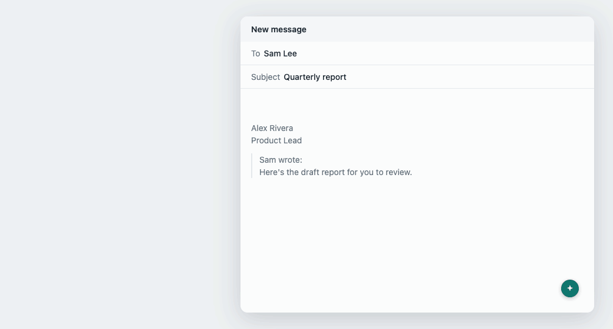
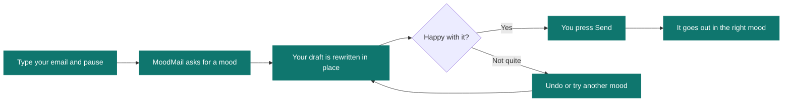
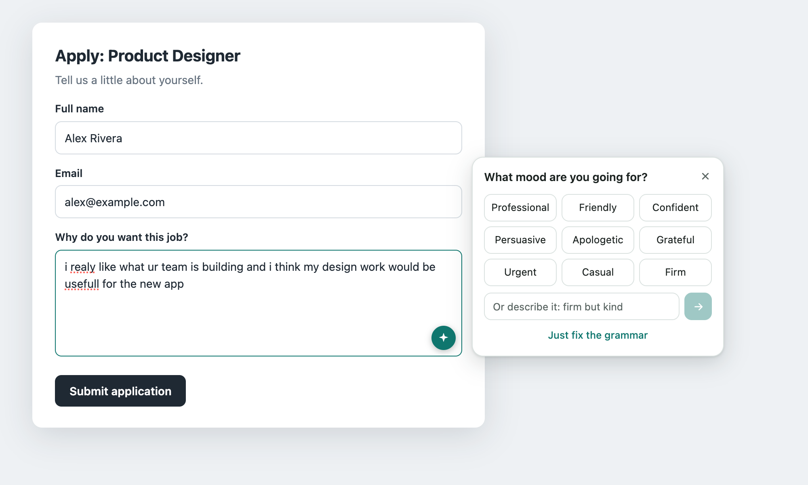
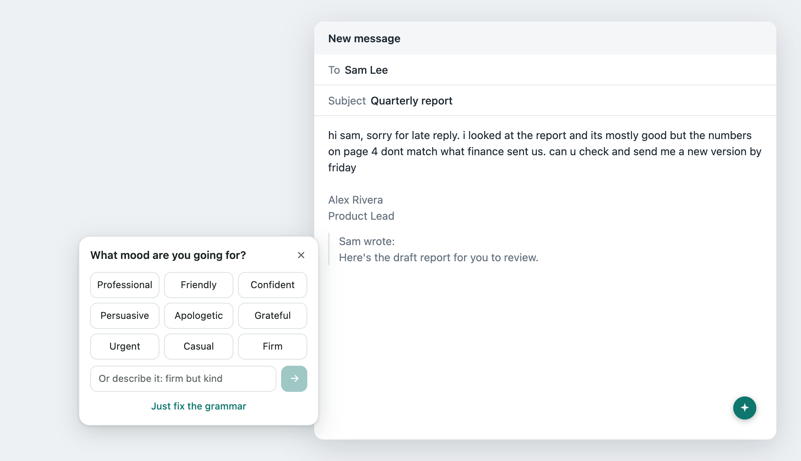
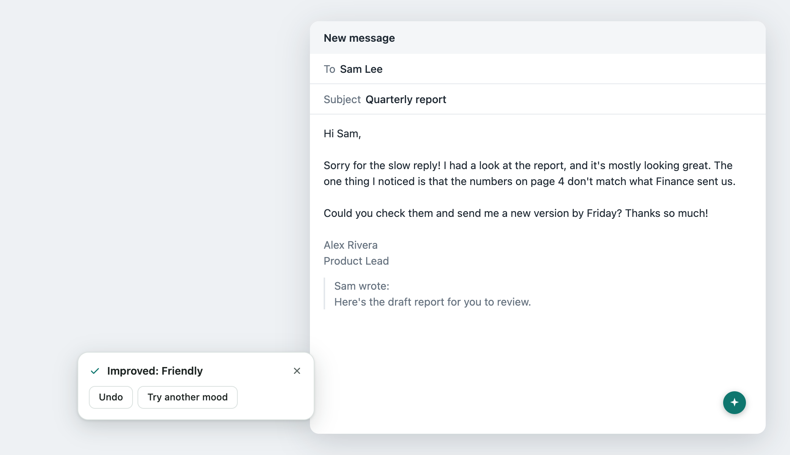
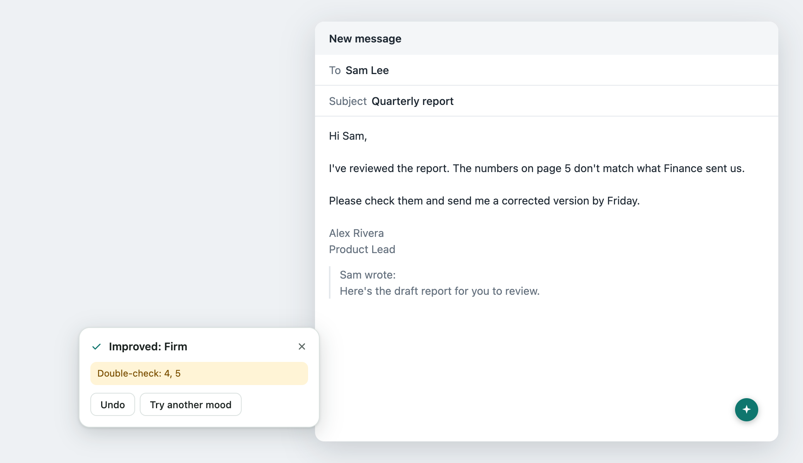
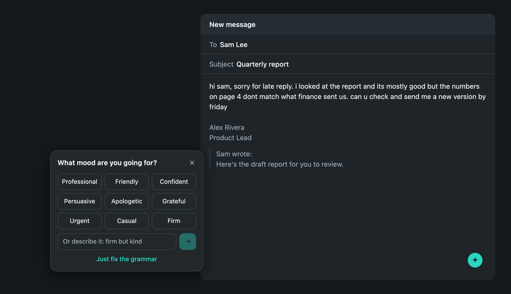
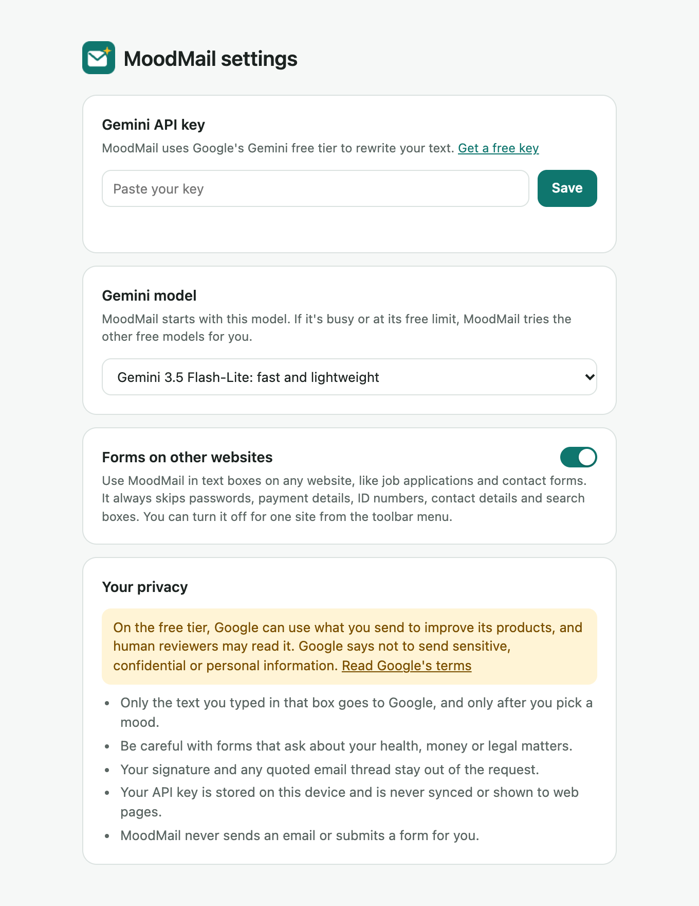
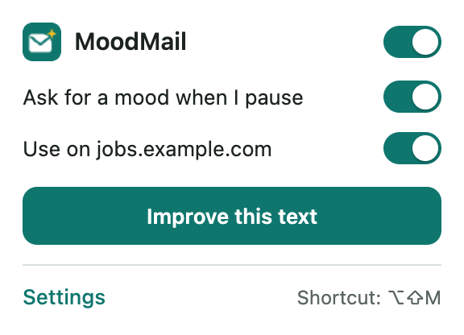
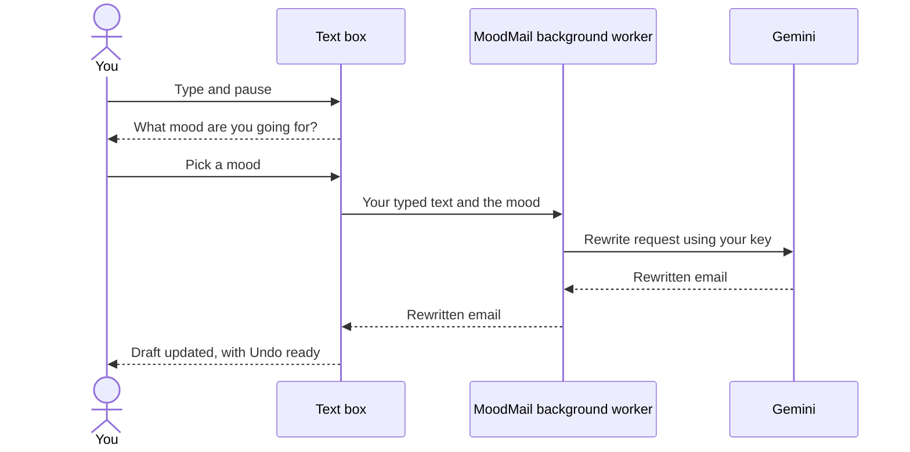

<div align="center">


# MoodMail

### Type it however it comes out. Pick a mood. Send the email you meant to write.

A Chrome extension that fixes your grammar and rewrites your text in the mood you choose, right where you're typing: in your inbox or in forms on any website.

<br>


<br><br>

[**Get started**](#get-started) &nbsp;·&nbsp; [**What it does**](#what-it-does) &nbsp;·&nbsp; [**Privacy**](#privacy) &nbsp;·&nbsp; [**Project status**](#project-status)

<br>



<sub>Illustrative demo with sample text.</sub>

</div>

<br>

## Why MoodMail

Spell-checkers catch your typos, but they can't tell you that your reply sounds too blunt, too stiff or too apologetic. MoodMail handles both. It cleans up your writing and reshapes it to fit the moment, in the box you're already typing in, without copying anything into another app.

## How it works



## What it does

<table>
<tr>
<td width="50%" valign="top">

**Cleans up your writing**<br>
Spelling, grammar, punctuation and capitalization are corrected every time.

</td>
<td width="50%" valign="top">

**Rewrites in your mood**<br>
Choose a preset, or describe exactly what you want, like *"firm but kind"* or *"excited but not over the top"*.

</td>
</tr>
<tr>
<td valign="top">

**Fixes grammar on its own**<br>
Happy with your tone? **Just fix the grammar** corrects the mistakes and leaves your wording alone.

</td>
<td valign="top">

**Asks at the right moment**<br>
It waits until you pause and never takes your cursor. Keep typing and it steps aside until your next pause.

</td>
</tr>
<tr>
<td valign="top">

**Lets you change your mind**<br>
**Undo** brings your draft back. **Try another mood** always starts from your original words, so meaning doesn't drift between rewrites.

</td>
<td valign="top">

**Flags changed details**<br>
If a number, link or email address differs after the rewrite, a **Double-check** note points it out before you send.

</td>
</tr>
</table>

### Same draft, different moods

> **Your draft**<br>
> hi sam, sorry for late reply. i looked at the report and its mostly good but the numbers on page 4 dont match what finance sent us. can u check and send me a new version by friday

<table>
<tr>
<th width="50%">Friendly</th>
<th width="50%">Professional</th>
</tr>
<tr>
<td valign="top">

Hi Sam,

Sorry for the slow reply! I had a look at the report, and it's mostly looking great. The one thing I noticed is that the numbers on page 4 don't match what Finance sent us.

Could you check them and send me a new version by Friday? Thanks so much!

</td>
<td valign="top">

Hi Sam,

Apologies for the delayed reply. I have reviewed the report and it is in good shape overall. However, the figures on page 4 do not match those provided by Finance.

Could you please check them and send me an updated version by Friday?

</td>
</tr>
</table>

<sub>Illustrative examples. Actual wording comes from Gemini and will vary.</sub>

### Moods to choose from

| Mood | How it sounds |
| :--- | :--- |
| 💼 **Professional** | Polished and respectful, clear without sounding stiff |
| 😊 **Friendly** | Warm and approachable, like a helpful colleague |
| 💪 **Confident** | Assured and decisive, with the hedging taken out |
| 🎯 **Persuasive** | Leads with what the reader gains and ends on a clear ask |
| 🙏 **Apologetic** | Sincere and owns the problem, without excuses or grovelling |
| 💛 **Grateful** | Genuinely thankful and specific about what you appreciate |
| ⏰ **Urgent** | Polite but pressing, focused on what needs to happen next |
| ☕ **Casual** | Relaxed and conversational, with contractions and short sentences |
| 🧱 **Firm** | Direct about expectations and boundaries, while staying civil |
| ✍️ **Your own** | Describe any mood you like in your own words |

### What it leaves alone

- **Your signature and quoted thread** stay exactly as they are and are never sent for rewriting.
- **Inline images and tables** stay where they belong.
- **Links, bold, italics and lists** carry through the rewrite.
- **Your font, text color and text direction** carry over too, including right-to-left writing.
- **Your facts:** Gemini is told to keep every name, date, amount and commitment, and not to invent anything. It's also told to write in the same language as your draft.

### Works on forms too

Job applications, contact forms, support requests, feedback boxes: MoodMail works in text boxes on any website, including forms embedded in a page. One-line fields join in once you've typed a full sentence, so it won't bother you about your name or a date.



<sub>Illustrative example on a sample form.</sub>

- **It only polishes your answer.** It doesn't add a greeting or sign-off.
- **Character limits are respected.** If a rewrite won't fit a field's limit, your text stays as it was and you can try again.
- **It never submits anything.** You read the result and press the form's button yourself.
- **Private fields are skipped.** It leaves alone anything it recognizes as a password or security code, card or bank details, an ID number, contact details, a search box or a code editor.

You can turn forms off in settings, or turn MoodMail off for a single site from the toolbar menu.

### Made to stay out of your way

- **It never sends anything.** You read the result and press Send yourself.
- **Your newest words are safe.** If you keep typing while a rewrite runs, MoodMail leaves your draft alone and offers to run it again.
- **Your cursor stays put.** Move to the subject line during a rewrite and you can keep typing there.
- **Each compose window is separate.** A rewrite always lands in the window it started from.
- **A busy model doesn't stop you.** If one free Gemini model is overloaded or at its limit, MoodMail moves on to the next one by itself.
- **You're in control.** Turn MoodMail off, or stop the automatic prompt and open it only when you want it.

## A closer look

<table>
<tr>
<td width="50%" valign="top">
<br>
<b>Pick a mood</b><br>
<sub>Choose a preset, describe your own, or just fix the grammar.</sub>
</td>
<td width="50%" valign="top">
<br>
<b>See the result in place</b><br>
<sub>Your signature and quoted thread are untouched.</sub>
</td>
</tr>
<tr>
<td valign="top">
<br>
<b>Catch changed details</b><br>
<sub>A note flags numbers, links and addresses that differ.</sub>
</td>
<td valign="top">
<br>
<b>Follows your system theme</b><br>
<sub>Light and dark are both built in.</sub>
</td>
</tr>
<tr>
<td valign="top">
<br>
<b>Simple setup</b><br>
<sub>Paste your key, choose a model and you're done.</sub>
</td>
<td valign="top">
<br>
<b>Controls in your toolbar</b><br>
<sub>Turn it on or off, for everywhere or one site, or start a rewrite.</sub>
</td>
</tr>
</table>

## Get started

You need Google Chrome on a computer and a free Gemini API key.

1. **Get the code.** Clone this repository, or use **Code → Download ZIP** above and unzip it.

   ```bash
   git clone https://github.com/moazzanimran2007/moodmail.git
   ```

2. **Load it into Chrome.** Open `chrome://extensions`, turn on **Developer mode** at the top right, click **Load unpacked** and choose the `moodmail` folder.

3. **Add your key.** The settings page opens by itself. Create a free key at [Google AI Studio](https://aistudio.google.com/api-keys), paste it in and click **Save**.

4. **Reload your open tabs.** Any tabs you already had open need a reload to pick up MoodMail.

> [!IMPORTANT]
> **Leave Developer mode on and keep the folder where it is.** Chrome loads the extension from that folder, and it turns extensions loaded this way off whenever Developer mode is off.

## Using MoodMail

| Way to open it | How |
| :--- | :--- |
| **Automatically** | Start typing an email or a form answer and pause. MoodMail asks for a mood. |
| **Button on the text box** | Click the round button at the corner of the box you're typing in. |
| **Keyboard shortcut** | Press `Alt+Shift+M`, or `Option+Shift+M` on a Mac. You can change it at `chrome://extensions/shortcuts`. |
| **Toolbar menu** | Click the MoodMail icon and choose **Improve this text**. The same menu turns MoodMail off for the site you're on. |

## Privacy

> [!WARNING]
> **Be careful with sensitive emails and forms.** On Gemini's free tier, Google can use what you send to improve its products, and human reviewers may read it. Google says not to send sensitive, confidential or personal information, so skip MoodMail for anything like that, including forms about your health, money or legal matters. Read [Google's terms](https://aistudio.google.com/docs/terms) for the details.

- **Nothing is sent until you pick a mood.** Typing and pausing stay on your computer.
- **Only the text you typed is sent.** Your signature, quoted thread, inline images and tables stay out of the request. On a form, only the box you're rewriting is sent, not the question or your other answers.
- **It runs on every website so it can find text boxes.** Chrome will say it can read and change your data on all sites. MoodMail looks only at the box you're using and how that box is labelled, and you can turn off forms or any single site.
- **Private fields are recognized, not guaranteed.** MoodMail goes by how a field is set up and labelled, so it could miss an unusually built one. Even then, nothing leaves your browser unless you pick a mood.
- **Your API key stays on your device.** It isn't synced, and web pages can't read it.
- **There's no MoodMail server and no analytics.** Your browser talks directly to Google.
- **Requests aren't kept for later retrieval.** MoodMail asks Google not to store them that way. This doesn't change the free-tier terms above.

## Good to know

- **Where it runs:** MoodMail is built for Gmail, Outlook on the web and Yahoo Mail in desktop Chrome, and for text boxes in forms on other websites.
- **Unusual text boxes:** some sites build their text boxes in ways MoodMail can't detect, so those won't get the button.
- **Free-tier limits:** Google limits how much you can use the free tier, and its free models can get overloaded. MoodMail tries each free model once per rewrite. If none can answer, it tells you why and leaves your draft alone.
- **Subject lines:** only the message body is rewritten.
- **Replies between quoted sections:** if you type in several places around a quote, only your first block of text is rewritten.

## Project status

> [!NOTE]
> **This is an early release.** It has mostly been tested in an automated browser against simulated email pages, sample forms and a simulated Gemini service, and it hasn't been fully verified on every live site yet. If something looks wrong on a real site, please [open an issue](https://github.com/moazzanimran2007/moodmail/issues) and say which site you were using.

<details>
<summary><b>Troubleshooting</b></summary>

<br>

| What you see | What to do |
| :--- | :--- |
| **No button on a text box** | Reload the tab. Check that MoodMail and Developer mode are both on at `chrome://extensions`. One-line fields need a full sentence first, and private fields are skipped on purpose. |
| **The button shows up where you don't want it** | Click the MoodMail icon and switch off **Use on** for that site. |
| **"The rewrite is over this field's limit"** | Press **Try again**, or use **Just fix the grammar**, which stays closer to your length. |
| **"Google rejected your API key"** | Copy the key again from Google AI Studio and make sure you got all of it. |
| **"Gemini's free models are all busy"** | Google is short on capacity. Wait a minute or two and try again. The card lists which models were tried. |
| **"You've hit Gemini's free limit"** | Wait a minute and try again. |
| **"You've used today's free Gemini allowance"** | The daily limit resets at midnight Pacific time. |
| **"Could not reach Google"** | Check your connection. After several failed tries, Chrome also pauses extension requests for a short time, so wait a minute and try again. |
| **"MoodMail was updated"** | Reload the email tab. |

</details>

<details>
<summary><b>Under the hood</b></summary>

<br>

MoodMail is plain JavaScript with no dependencies and no build step.



| File | What it does |
| :--- | :--- |
| `manifest.json` | Extension setup, permissions and the keyboard shortcut |
| `background.js` | Reads your saved key and calls Gemini |
| `content.js` | Finds the compose box or form field, shows the mood picker and swaps in the rewrite |
| `popup.html`, `popup.js` | The toolbar menu |
| `options.html`, `options.js` | The settings page |
| `ui.css` | Styles for the toolbar menu and settings page |

</details>

<br>

<div align="center">
<sub>MoodMail is an independent project and isn't affiliated with Google, Microsoft or Yahoo.</sub>
</div>
